# Guia Completo — Lenda da Brasa

Guia passo a passo para terminar Lenda da Brasa do começo ao fim — os 3 castelos, os 8 santuários, a Fortaleza Sombria e o Coração do Abismo, com a rota de cada castelo, onde estão os itens e como vencer cada chefe.

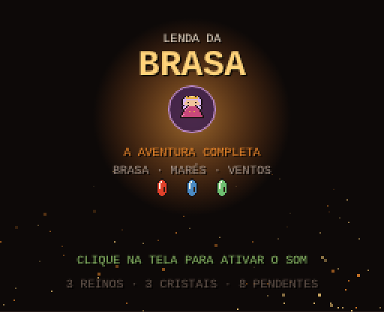

Jogue de graça no navegador: abra o `index.html` deste repositório ou o [Portal Pixel](https://hebersonmiliano.github.io/portal-jogos/jogo.html?id=lenda-da-brasa).

**Índice:** [Como começar](#como-começar) · [Itens](#itens-e-equipamentos) · [Capítulo 1](#capítulo-1--reino-da-brasa) · [Capítulo 2](#capítulo-2--reino-das-marés) · [Capítulo 3](#capítulo-3--reino-dos-ventos) · [Santuários](#os-8-santuários) · [Chefes](#chefes) · [Segredos](#segredos-e-dicas)

## Como começar

O Rei Umbra raptou a Princesa Lírian. Você é Lume e precisa reunir os **3 cristais** dos reinos da Brasa, das Marés e dos Ventos para libertar a **Espada dos Reinos**. Depois, busque os **8 Pendentes Celestiais** que abrem o caminho até o Reino Sombrio.

O jogo roda no navegador, no computador ou no celular. São **3 espaços de salvamento** neste navegador, e o jogo salva sozinho a cada tela.

| Ação | Teclado | Controle |
| --- | --- | --- |
| Andar (8 direções) | WASD ou setas | Direcional ou analógico |
| Espada, falar, abrir baú | J, Espaço ou Z | A |
| Usar o item equipado | K ou X | B ou X |
| Abrir os itens | I | Y |
| Pausa (salvar, sair, som) | Enter ou Esc | Start |
| Mapa mundi (ao ar livre) ou mapa do castelo (lá dentro) | TAB | Select |
| Ligar ou desligar o som | M | — |

Com a vida cheia, a espada solta uma **onda de brasa** à distância. No celular, use os botões na tela.

### Mapa Mundi

A qualquer momento, ao ar livre, aperte **TAB** (ou escolha MAPA MUNDI no menu de pausa) para ver o mapa completo com o nome de cada lugar dos 4 reinos — Brasa, Marés, Ventos e Sombrio. Use ESQUERDA/DIREITA para trocar de reino.

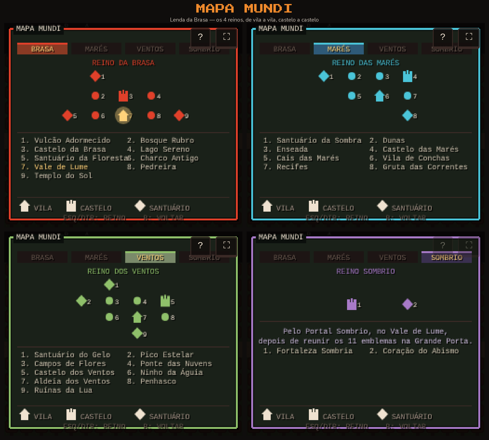

## Itens e equipamentos

Cada castelo e cada santuário guarda um item novo num **baú grande** (vermelho). Equipe o item no botão B pelo menu de itens.

| Item | Onde está | Para que serve |
| --- | --- | --- |
| Espada do Aprendiz | Caverna do Ancião, Vale de Lume | Atacar; com vida cheia lança a onda de brasa |
| Bumerangue | Baú no Lago Sereno | Atordoa inimigos e busca itens |
| Bastão de Brasa | Castelo da Brasa, subsolo | Acende braseiros e queima barricadas |
| Gancho | Castelo das Marés, cisterna | Puxa você até postes e baús por cima da água e de buracos |
| Pena | Castelo dos Ventos, 1º andar | Pulo curto sobre buracos, vento e ondas de choque |
| Espada dos Reinos | Após o 3º cristal | Dobro de dano e abre os portais dos santuários novos |
| Arco do Sol | Templo do Sol | Flechas acertam os olhos de pedra nas paredes |
| Bombas | Santuário da Floresta | Derrubam paredes muito rachadas e rochas partidas |
| Lanterna das Almas | Santuário da Sombra | Ilumina o escuro, acende braseiros e mostra pontes fantasmas |
| Bastão de Gelo | Santuário do Gelo | Congela a água e cria chão, um bloco por vez |
| Martelo da Lua | Ruínas da Lua | Afunda estacas e quebra armaduras |

Em cada castelo e santuário você também acha o **mapa**, a **bússola** (mostra baús que faltam e o chefe), **chaves pequenas** que só servem ali e a **chave mestra** da porta do chefe.

## Capítulo 1 — Reino da Brasa

Objetivo: pegar a espada, atravessar o Castelo da Brasa (20 salas, térreo e subsolo) e vencer o Guardião de Cinzas para ganhar o **Cristal da Brasa**.

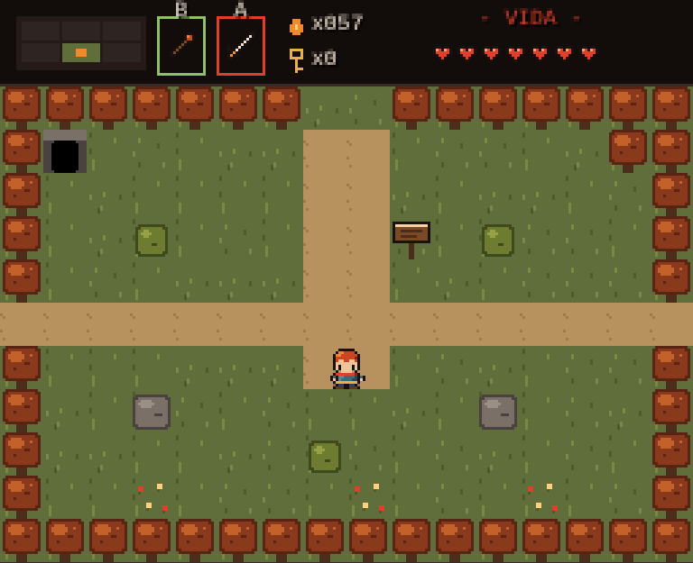

1. No **Vale de Lume**, entre na caverna do canto superior esquerdo e pegue a **espada** com o Ancião.
2. Opcional: no **Lago Sereno**, a nordeste, há um baú com o **bumerangue**.
3. Suba até o **Portão do Castelo**, ao norte do vale, e entre pelo portão.

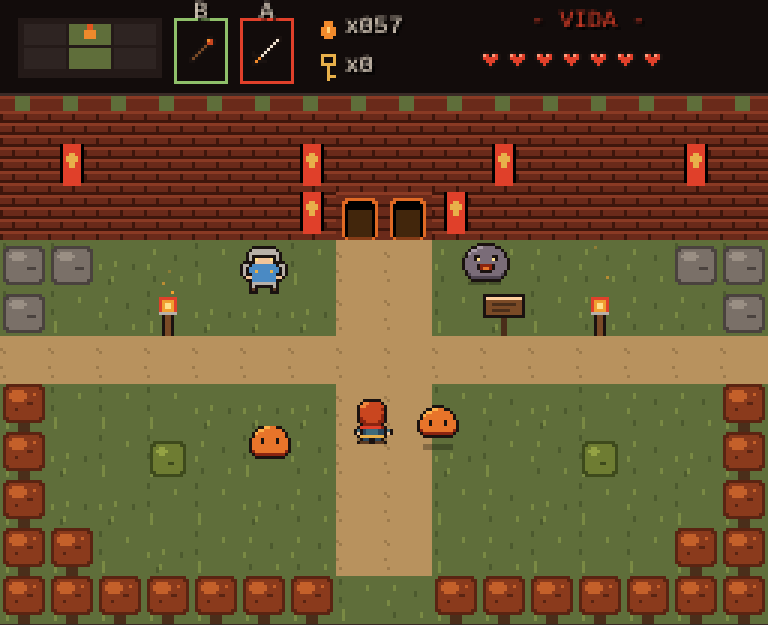

### Rota do Castelo da Brasa

O castelo tem 3 chaves pequenas e 3 portas trancadas, e dá para abrir as portas em qualquer ordem sem ficar preso. Aperte **TAB** para ver o mapa depois de achá-lo.

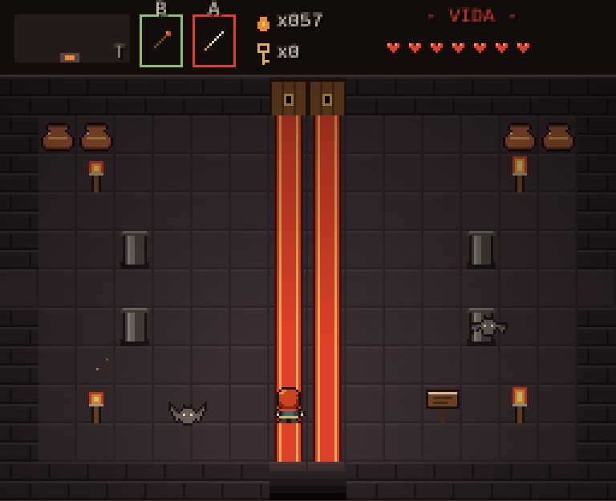

1. **Átrio:** a porta norte está trancada, deixe para depois. Vá ao **oeste (Galeria Oeste)** e pegue o **MAPA**.
2. **Sala das Colunas** (norte): bata no **orbe azul** com a espada. Os pinos azuis baixam e libera a **1ª chave**. Bata de novo para baixar os pinos laranja da saída norte.
3. **Corredor das Armaduras:** as portas trancam e vêm ondas de inimigos. Vencendo, ganha a **BÚSSOLA**.
4. **Câmara Escura** (oeste): cuidado com os buracos. A escada no canto superior esquerdo desce ao **subsolo**.
5. **Subsolo:** Cripta → sul, **Poço das Almas** (armadilha, **2ª chave**) → leste, **Ossuário** (use uma chave na porta leste) → **Ponte das Chamas** (bata no orbe no meio da ponte) → **Câmara do Bastão**.
6. **Câmara do Bastão:** vença as 2 ondas e pegue o **BASTÃO DE BRASA** no baú grande. A escada do canto inferior direito sobe para a Forja.
7. **Forja:** queime a barricada leste. Na **Sala dos Quatro Braseiros**, acenda os 4 cantos antes que apaguem e ganhe a **3ª chave**.
8. **Forja → porta norte → Biblioteca** (acenda os braseiros) **→ Torre Leste:** não entre no cantinho do orbe. Acerte o orbe **de longe** com o bastão, queime a barricada e pegue a **CHAVE MESTRA**.
9. **Antessala do Trono:** a porta grande leva ao **Guardião de Cinzas**.

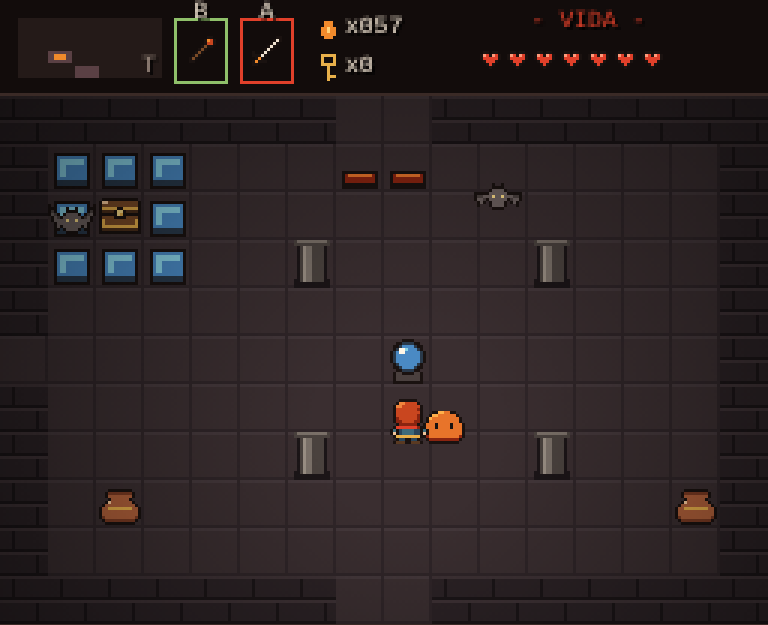

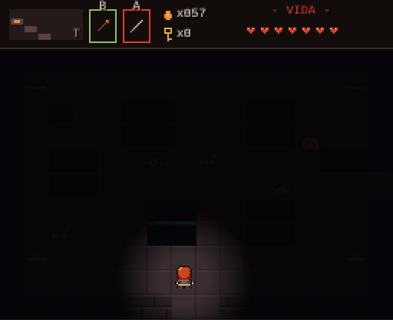

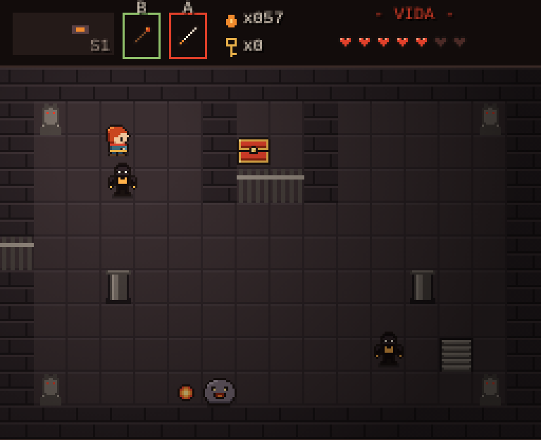

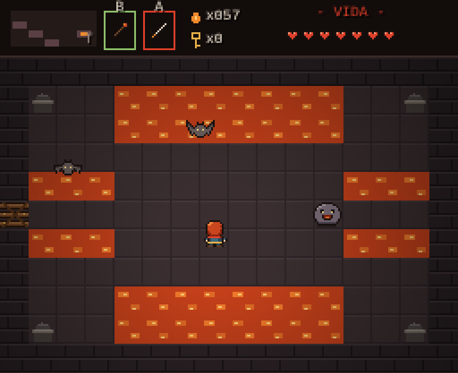

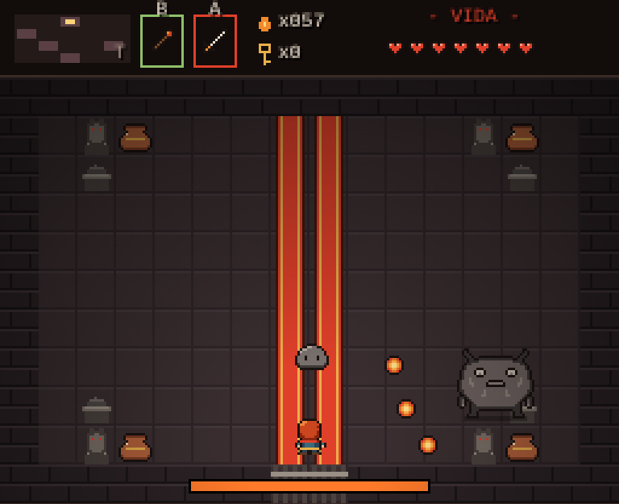

## Capítulo 2 — Reino das Marés

Objetivo: atravessar o Castelo das Marés (16 salas, térreo e cisterna), pegar o **Gancho** e vencer o Kraken para ganhar o **Cristal das Marés**.

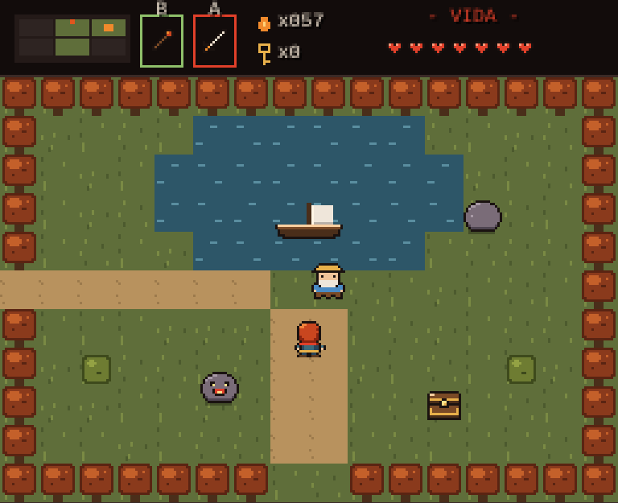

1. Com o Cristal da Brasa, fale com o barqueiro **Bento** no **Lago Sereno**. Ele leva você ao **Cais das Marés**.
2. Na **Vila de Conchas**, o pescador Tito dá dicas. O castelo fica no **Portão das Marés**, no canto superior direito do reino.

### Rota do Castelo das Marés

Tudo gira em torno da **maré**. A alavanca das Comportas sobe e baixa a água do castelo inteiro:

- **Maré cheia:** as plataformas de madeira flutuam e dá para andar nelas.
- **Maré vazante:** os canais secam, mas as plataformas viram buracos.

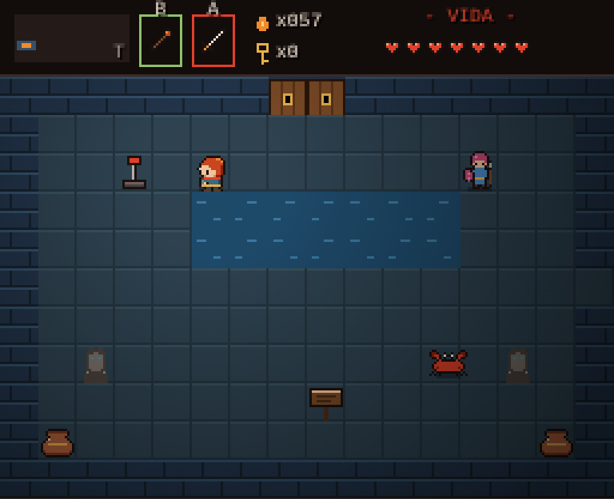

1. **Átrio:** a porta norte está bloqueada pela água. Vá ao **oeste (Ala Oeste)** e pegue o **MAPA**.
2. **Grande Poço** (norte): com a maré **cheia**, siga as plataformas até a ilha da **1ª chave**.
3. **Comportas** (oeste): aqui fica a alavanca. Use a chave na porta norte.
4. **Aquário:** a escada está no fundo de uma piscina. Volte às Comportas, **baixe a maré** e desça. A leste, a **Galeria das Conchas** é uma armadilha que dá a **BÚSSOLA**.
5. **Cisterna → Galeria Submersa:** armadilha com a **2ª chave** e uma segunda alavanca. **Suba a maré**.
6. **Câmara do Gancho:** siga as plataformas até a ilha e pegue o **GANCHO**. Lance o gancho no poste à direita e suba a escada até as **Docas**.
7. **Docas:** gancho no poste ao norte para cruzar a água. Use a 2ª chave na porta trancada da **Torre do Farol**.
8. **Torre do Farol:** gancho no poste acima da ilha, depois no poste à esquerda: **CHAVE MESTRA**. Para voltar, mire o gancho para baixo, no poste da margem.
9. **Antessala do Trono:** chegue pela **Ponte da Maré**. A porta grande leva ao **Kraken**.

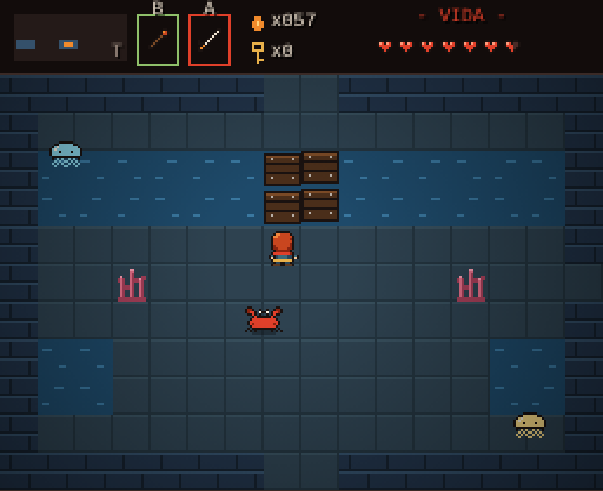

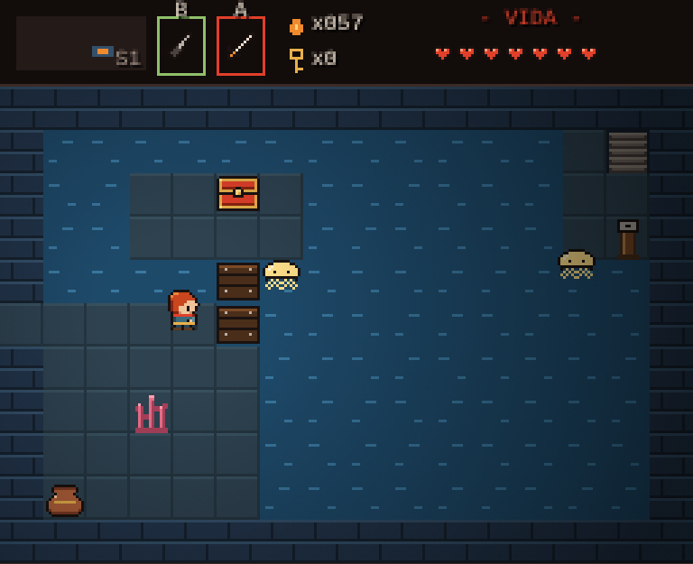

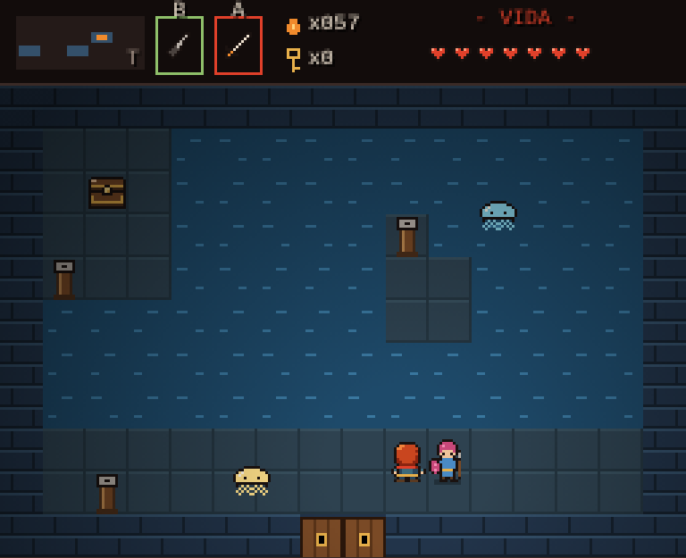

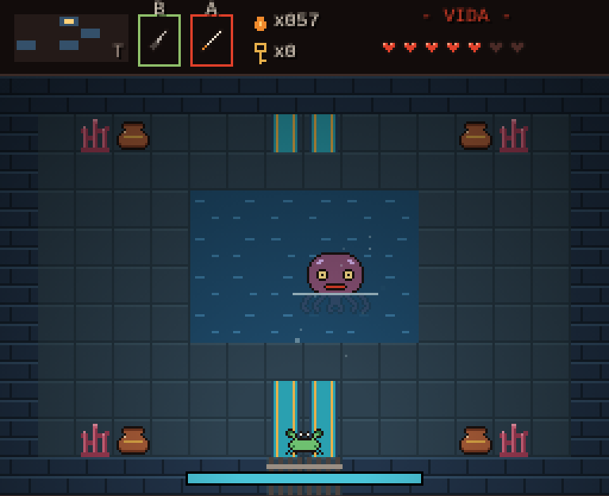

## Capítulo 3 — Reino dos Ventos

Objetivo: subir o Castelo dos Ventos (16 salas em 3 andares), pegar a **Pena** e vencer o Grifo. Com o **Cristal dos Ventos**, a **Espada dos Reinos** é libertada.

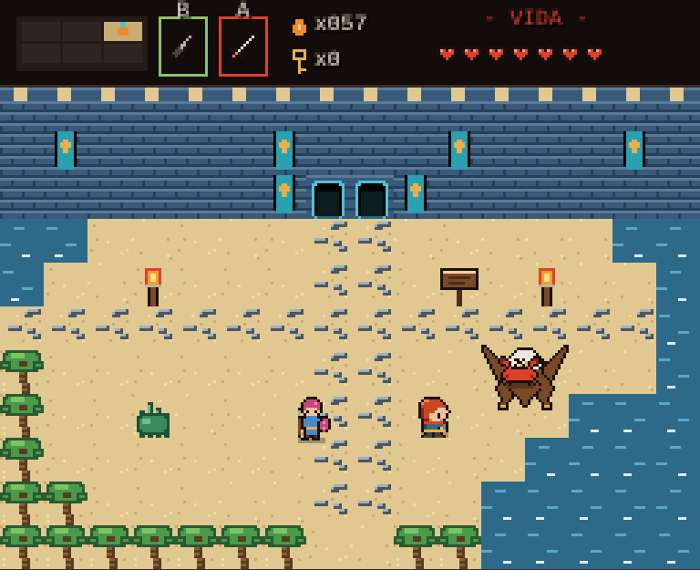

1. Com 2 cristais, fale com a **águia gigante** no **Portão das Marés**. Ela leva você ao **Ninho da Águia**.
2. Na **Aldeia dos Ventos**, o Irmão Vento dá dicas. O castelo fica no **Portão dos Ventos**, no canto superior direito.

### Rota do Castelo dos Ventos

Neste castelo os **pisos rachados desabam** se você parar em cima deles, e as **correntes de vento** empurram você para o abismo.

1. **Átrio:** a porta norte está trancada. Vá ao **oeste (Ala Oeste)** e pegue o **MAPA**.
2. **Jardim Suspenso** (norte): atravesse as pontes de piso rachado **sem parar** até a **1ª chave**. Volte pela outra ponte.
3. **Torre Oeste:** os orbes trocam os pinos. Abra caminho até a escada e suba à **Varanda dos Ventos**.
4. Pelo outro lado do Átrio: **Ala Leste** é uma armadilha que dá a **2ª chave**. Ao norte, no **Salão das Correntes**, ande contra o vento até a **BÚSSOLA**.
5. Use as chaves na **porta norte do Átrio** ou na **Varanda** (1º andar). Os dois caminhos levam à **Câmara da Pena**.
6. **Câmara da Pena:** bata no orbe para baixar os pinos azuis e pegue a **PENA**. Pule o abismo do lado leste com ela.
7. **Ponte Partida:** pule os vãos sem deixar o vento empurrar você. Pegue a **3ª chave** e suba a escada até a torre.
8. **Corredor Quebradiço → Antessala do Ninho → Mirante do Vendaval:** contra o vento, pule até a ilha da **CHAVE MESTRA**.
9. **Antessala do Ninho:** a porta grande leva ao **Grifo**.

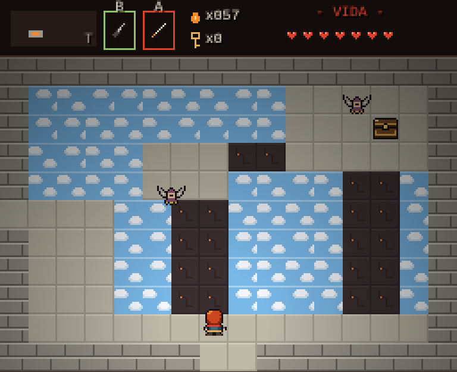

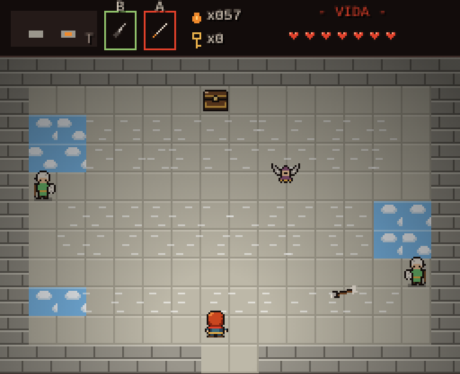

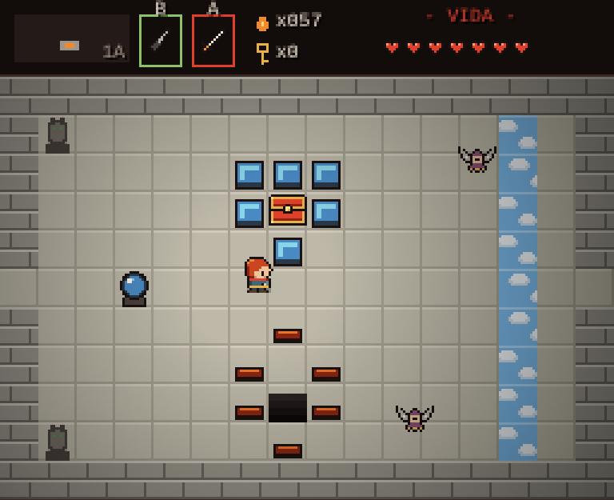

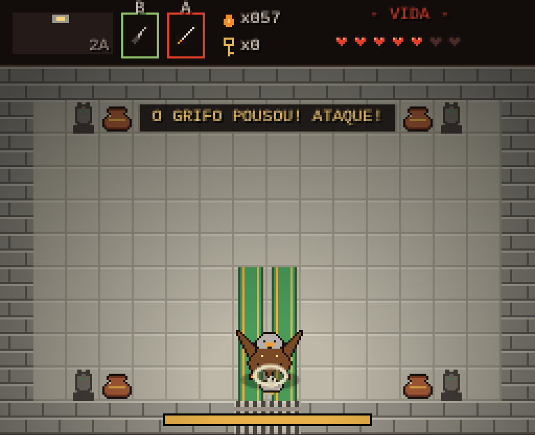

## Os 8 santuários

Cada santuário guarda um **Pendente Celestial**. Fogo e Mar abrem desde o começo. Os outros pedem a **Espada dos Reinos**, e o Pico Estelar só abre com os outros 7 Pendentes.

| Ordem sugerida | Santuário | Como chegar | Item | Mini-chefe |
| --- | --- | --- | --- | --- |
| 1 | Santuário do Fogo | Vulcão, ao norte do Bosque Rubro | — | Salamandra de Lava |
| 2 | Gruta das Correntes | Portal nos Recifes (Marés) | — | Caranguejo Rei |
| 3 | Templo do Sol | Leste da Pedreira → Deserto Escaldante | Arco | Escorpião Dourado |
| 4 | Santuário da Floresta | Oeste do Charco Antigo → Floresta Antiga | Bombas | Flor Devoradora |
| 5 | Santuário da Sombra | Oeste das Dunas → Pântano Sombrio | Lanterna | Espectro |
| 6 | Santuário do Gelo | Norte dos Campos de Flores → Geleira Eterna | Bastão de Gelo | Yeti das Neves |
| 7 | Ruínas da Lua | Sul da Aldeia dos Ventos → Ruínas Lunares | Martelo | Cavaleiro da Lua |
| 8 | Pico Estelar | Oeste dos Campos de Flores | Todos os anteriores | Guardião Estelar |

### Santuário do Fogo e Gruta das Correntes

- **Fogo:** nas Três Chamas, acenda os 3 braseiros com o Bastão de Brasa em menos de 5 segundos cada; dois ficam em ilhas de lava. Na Ponte de Lava, use os postes do gancho.
- **Mar:** empurre os 3 blocos até os botões. Um deles é de enfeite. No Lago Escuro, siga os postes com o gancho.

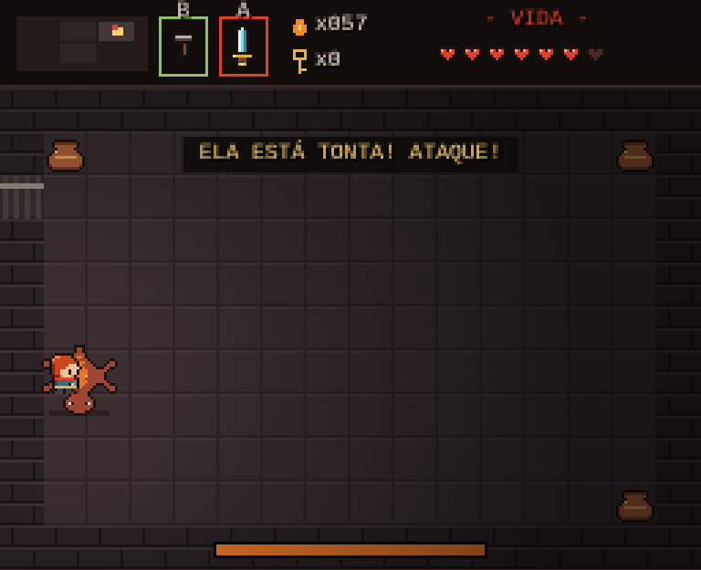

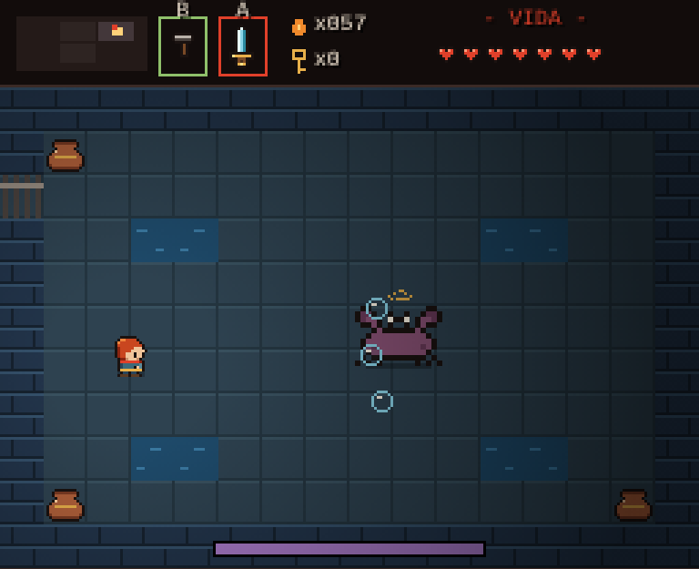

### Templo do Sol — Arco

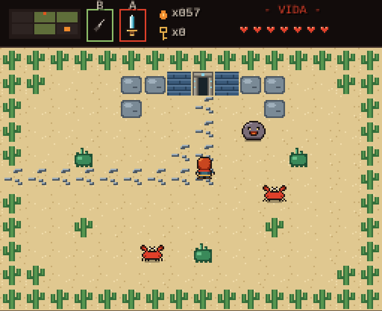

1. **Galeria das Areias** (oeste): **MAPA**. **Oásis Perdido** (norte): acerte o orbe na ilha com o bastão ou o gancho para pegar a **1ª chave**.
2. **Relógio de Sol** (leste, pela Escarpa): acenda os 4 braseiros a tempo para a **2ª chave**. Na Escarpa, o gancho leva à **BÚSSOLA** na ilha.
3. **Salão dos Ecos** (porta trancada no Oásis) → escada → **Arena do Arco**: vença as ondas e pegue o **ARCO**.
4. **Câmara dos Três Olhos:** flecha nos 3 olhos de pedra para a **3ª chave**. A escada sobe ao Mar de Areia.
5. **Colunata dos Olhos** (porta trancada no Pátio): 2 olhos abrem a porta da Antessala.
6. **Tesouro do Sol:** acerte os 3 olhos em até 6 segundos para a **CHAVE MESTRA**.

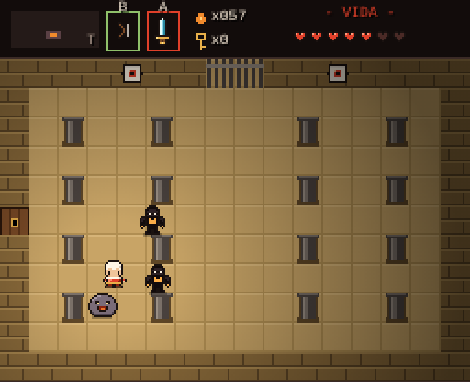

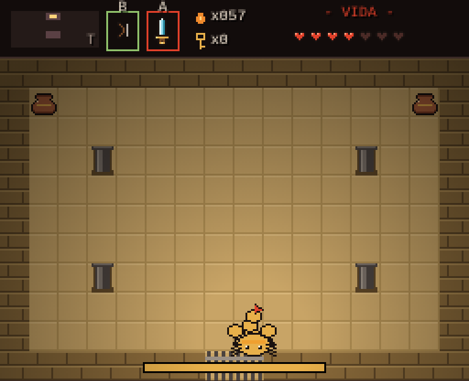

### Santuário da Floresta — Bombas

1. **Riacho Escondido:** **MAPA**. **Bosque de Cogumelos:** armadilha, **1ª chave**. **Toca Escura:** acenda os 4 braseiros para a **2ª chave**. **Câmara do Musgo:** blocos nos botões, **BÚSSOLA**.
2. **Raiz Mestra → porta norte → Tronco Oco:** suba à copa. No **Ninho das Bombas**, vença a arena e pegue as **BOMBAS**.
3. **Colmeia de Pedra** (porta trancada nos Galhos): exploda as rochas rachadas para a **3ª chave** e a saída norte.
4. **Ponte de Cipós:** postes do gancho até a escada do topo.
5. **Seiva Dourada:** bomba na parede rachada e gancho no baú da ilha para a **CHAVE MESTRA**.

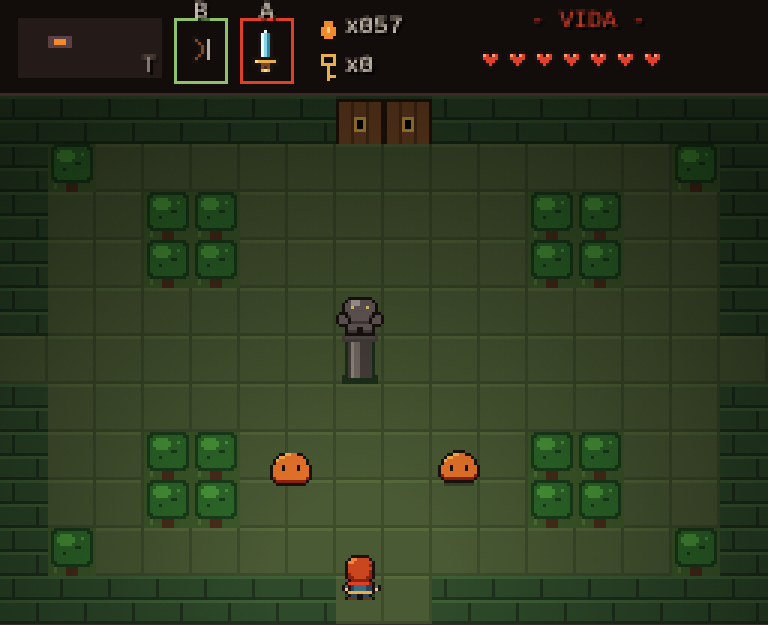

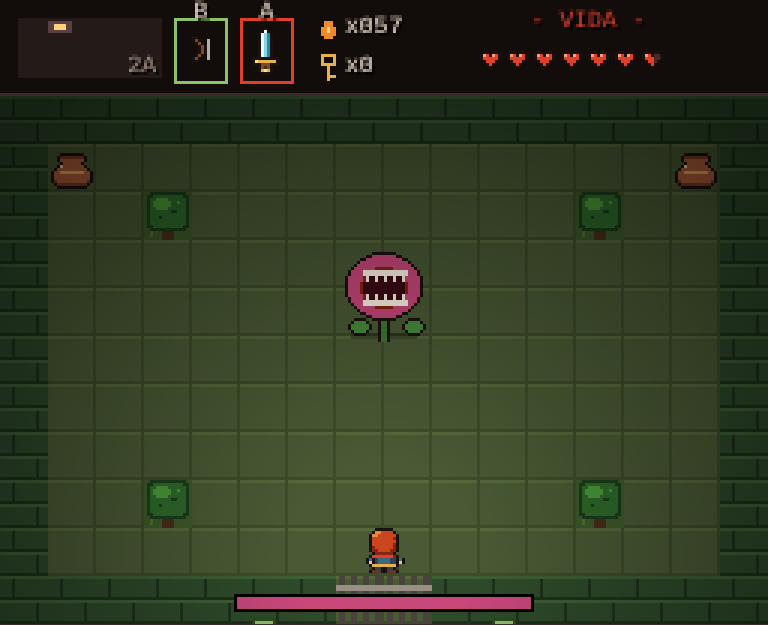

### Santuário da Sombra — Lanterna

Todas as salas são escuras. **Pontes fantasmas** são caminhos invisíveis sobre o abismo, e só a lanterna mostra onde estão.

1. **Ossário:** **MAPA**. **Corredor Gélido:** armadilha, **1ª chave**. **Cripta Leste:** acenda os 4 braseiros para a **2ª chave**.
2. **Capela Abandonada** (porta trancada) → escada → **Arena da Lanterna:** **LANTERNA**.
3. **Ponte Fantasma:** siga a ponte revelada até a **3ª chave** e a escada que sobe à Sala dos Ecos.
4. **Torre do Sino:** ponte fantasma até a **BÚSSOLA**. **Cofre das Almas:** acenda as 4 chamas pelas pontes para a **CHAVE MESTRA**.

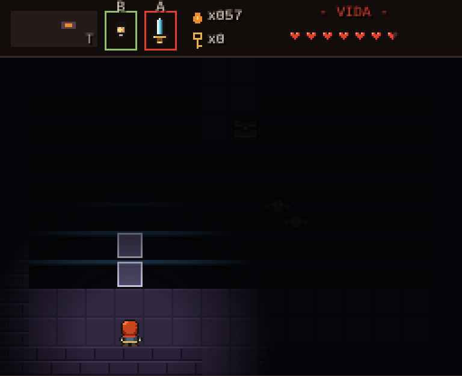

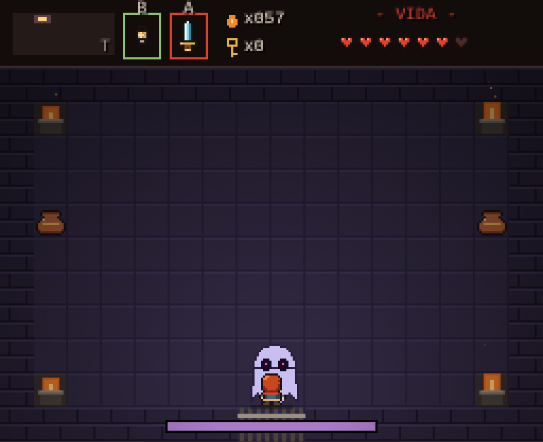

### Santuário do Gelo — Bastão de Gelo

1. **Câmara de Neve:** **MAPA**. **Pátio Congelado:** armadilha, **1ª chave**. **Fenda de Gelo** (porta trancada): desce às cavernas.
2. **Arena do Gelo:** vença as ondas e pegue o **BASTÃO DE GELO**.
3. **Cachoeira Congelada:** congele 2 blocos de água e atravesse até a **2ª chave**. **Estalactites:** orbe na ilha, **BÚSSOLA**.
4. **Lago Subterrâneo:** congele um caminho até a escada da ilha e desça ao Coração Gelado. **Fonte Congelada:** **3ª chave**.
5. **Cofre Glacial:** congele a água, use o gancho no baú e pegue a **CHAVE MESTRA**.

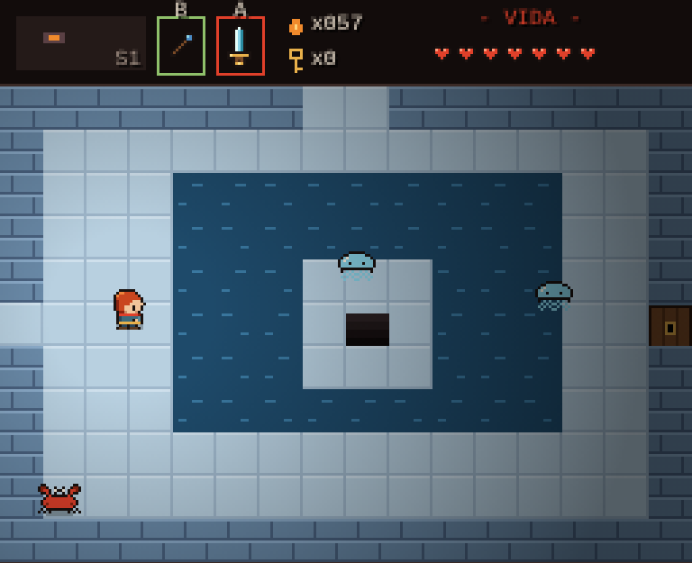

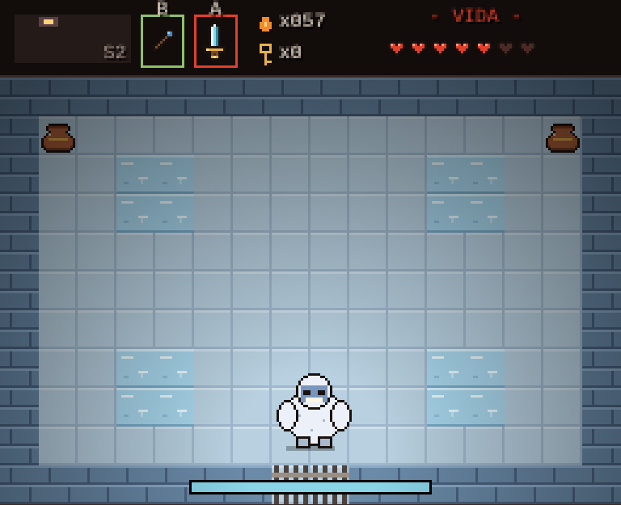

### Ruínas da Lua — Martelo

1. **Salão Partido:** **MAPA**. **Galeria Lunar:** armadilha, **1ª chave**. Use-a na porta leste do Portal.
2. **Arena da Lua:** vença as ondas e pegue o **MARTELO**. Com ele, afunde as **estacas** que lacram as passagens.
3. **Cavaleiros de prata:** a espada não fere. Uma martelada racha a armadura.
4. **Mirante Lunar:** martele o anel de estacas para a **2ª chave**. **Câmara dos Cavaleiros** (subsolo): armadilha, **3ª chave**.
5. **Câmara da Lua Cheia:** fique do lado esquerdo e acerte o orbe da direita **com flecha** através da linha laranja: os pinos azuis baixam e liberam a **CHAVE MESTRA**.

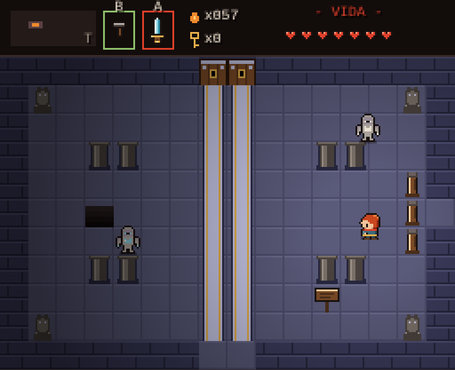

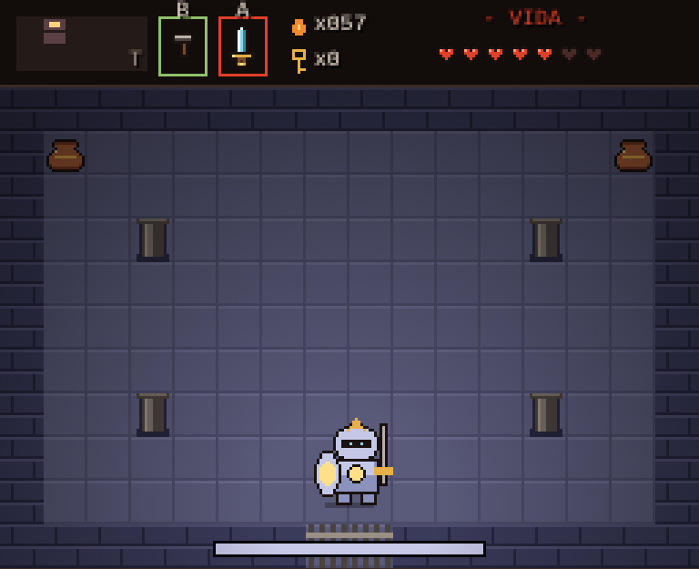

### Pico Estelar — a prova final

Uma torre de 5 andares em que cada sala pede um item diferente.

1. **Base da Torre:** flechas nos 2 olhos abrem a porta. **Câmara Gélida** (gelo): **MAPA**. **Câmara Rachada** (bombas): **1ª chave**.
2. **Câmara Sombria** (lanterna): ponte fantasma até a **BÚSSOLA**. **Câmara das Estacas** (martelo): escada para cima.
3. **Ponte dos Ventos:** ande **na diagonal** contra o vento para não cair. **Observatório Estelar:** acerte o orbe de longe para a **2ª chave**.
4. **Cofre Estelar:** 3 olhos em até 7 segundos para a **CHAVE MESTRA**. **Corredor do Vazio:** dois pulos com a pena até a Antessala.

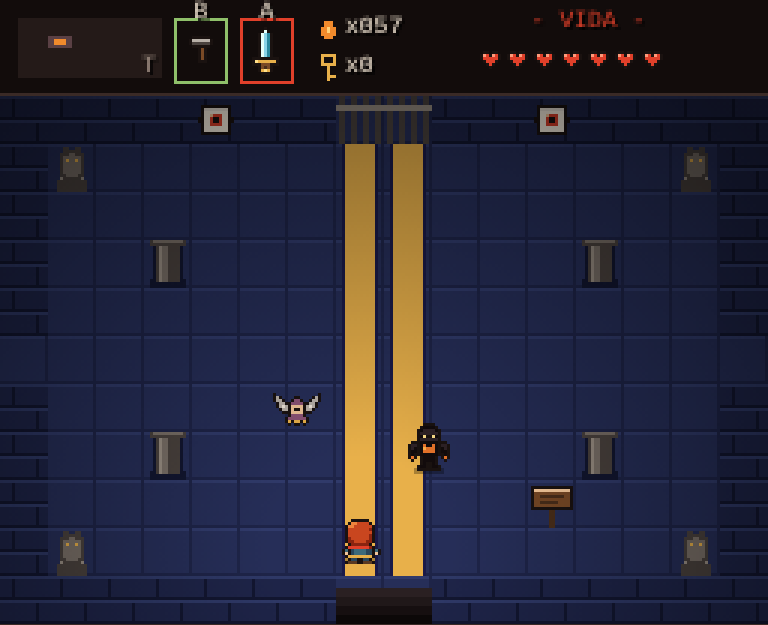

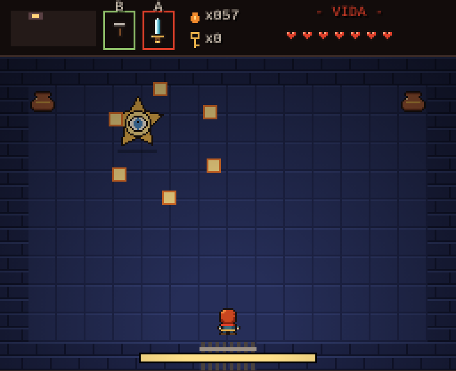

## Capítulo 4 — O Reino Sombrio

Com os **8 pendentes**, um **portal sombrio** se abre no **Vale de Lume**, a sudeste, perto do caminho que leva ao lago. Ele leva à **Fortaleza Sombria**, onde o Rei Umbra prende a Princesa Lírian.

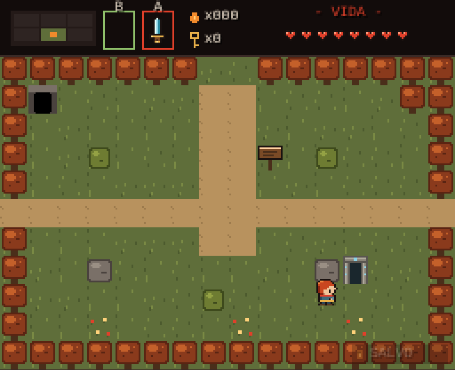

### Rota da Fortaleza Sombria

São 12 salas num único andar. Itens usados: Bastão de Gelo, Arco, Lanterna, Pena, Gancho e Martelo.

1. **Portão Negro → Pátio das Sombras** (norte).
2. **Câmara Gélida Negra** (oeste do pátio): o **MAPA** está no canto. Congele a água com o **Bastão de Gelo** para chegar à ilha da **1ª chave**.
3. **Galeria dos Olhos Negros** (leste do pátio): flechas nos **2 olhos** fazem surgir a **BÚSSOLA**.
4. Abra a porta trancada ao norte do pátio: **Salão Negro**.
5. **Cripta das Almas** (oeste do salão, escura): com a **Lanterna**, a ponte fantasma aparece até a **2ª chave**. Ao norte dela fica a **Torre dos Ventos Negros**: suba no vento e pule os buracos com a **Pena** até o **pedaço de coração**.
6. Abra a porta trancada a leste do salão: **Arsenal do Rei**. Use o **Gancho** no poste para cruzar a água e o **Martelo** nas estacas: **CHAVE MESTRA**. Ao norte do arsenal, a **Câmara do Tesouro** tem uma armadilha de ondas e **50 brasas**.
7. Ao norte do salão: **Antessala do Trono** e a porta grande.

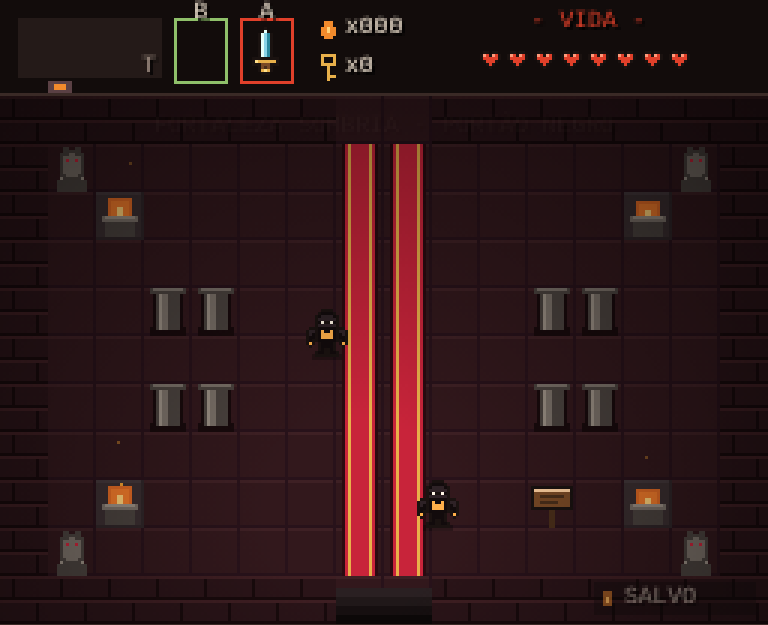

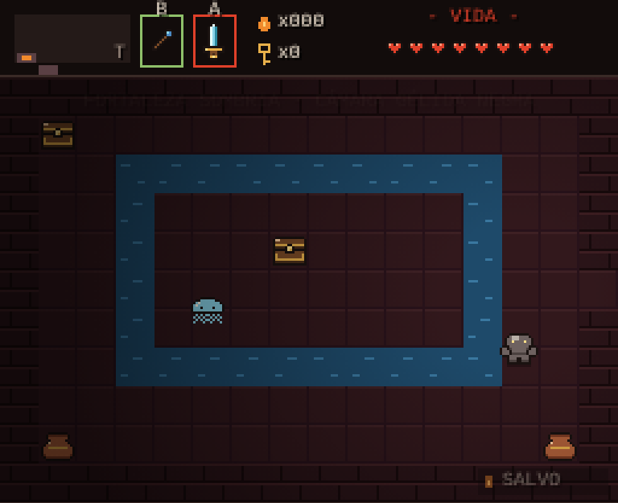

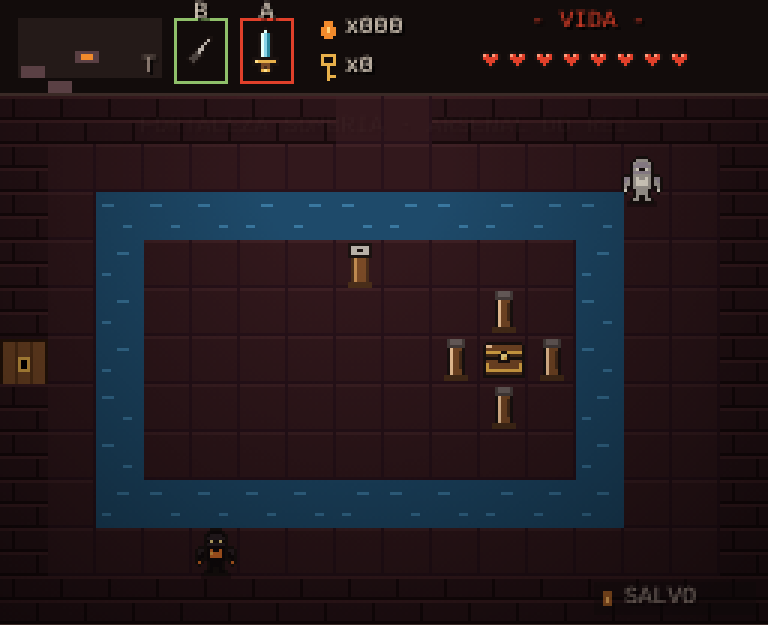

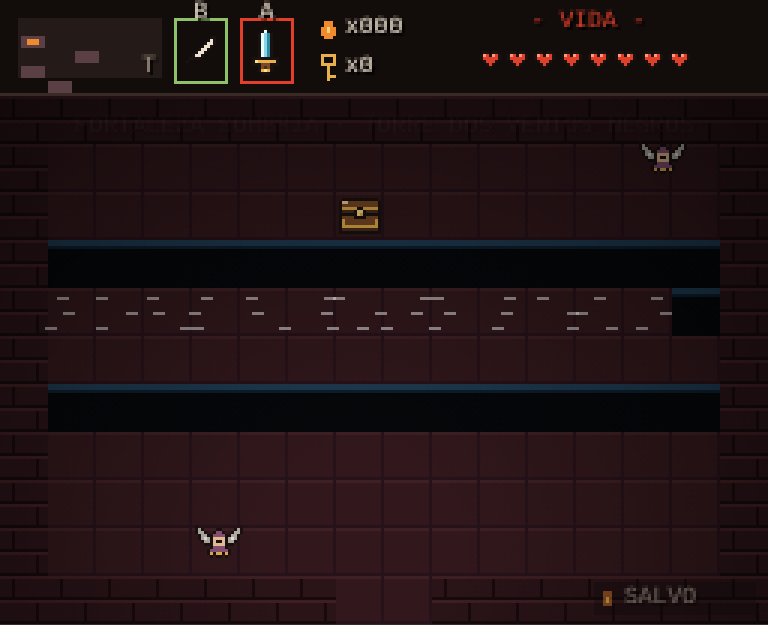

### O Rei Umbra

Nenhuma arma fere o rei diretamente. Ele lança **esferas de energia roxa**: **golpeie a esfera com a espada** quando ela chegar perto e ela volta, dourada, até ele. Acertado pela própria magia, o rei fica **tonto** por uns 2 segundos: é a hora de atacar. Ele também se **teletransporta** pela sala. Abaixo da metade da vida, solta **anéis de sombra** e chama **morcegos**.

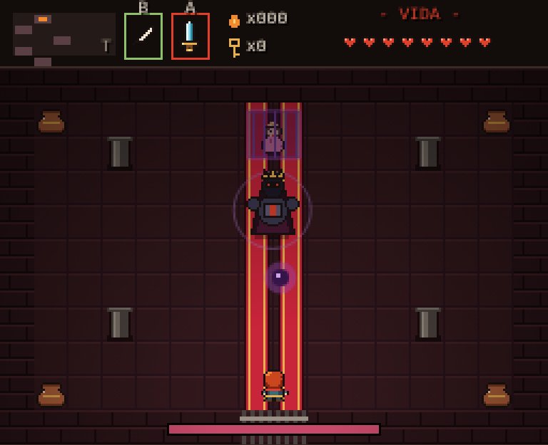

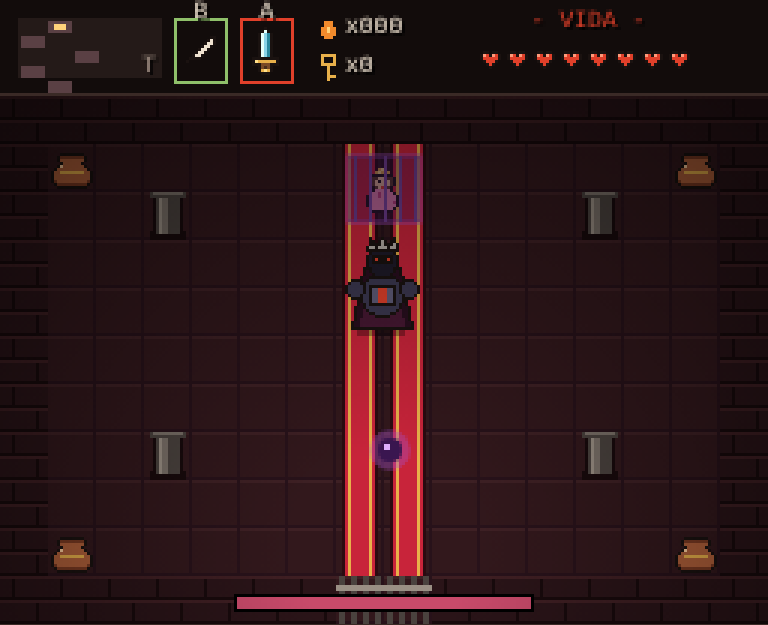

Vencido o rei, a princesa é libertada... mas conta que a **Sombra do Rei** ainda vive. A escuridão puxa você para o abismo.

## Capítulo 5 — O Coração do Abismo

### A Grande Porta

No **Portão do Abismo** está a Grande Porta, com **11 encaixes**. Os **3 cristais** e os **8 pendentes** saem do seu inventário e se encaixam um a um, e a porta se abre. Desta sala, a escada para baixo leva de volta ao Vale de Lume.

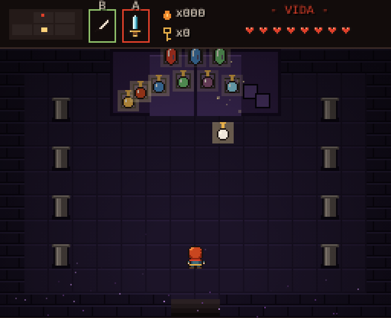

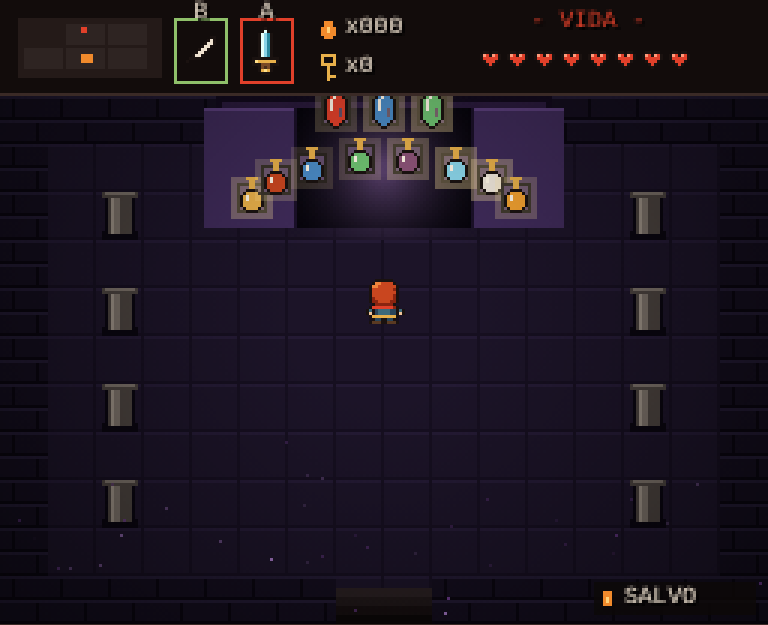

### As 11 salas de memória

Cada sala é um **eco** de um lugar por onde você passou, tingido de roxo. A barra de 11 quadradinhos embaixo mostra em qual eco você está. Sempre siga para o **norte**.

| Eco | Desafio | Como passar |
| --- | --- | --- |
| 1. Brasa | 4 braseiros e lava | Acenda os 4 com o Bastão de Brasa em até 6 s |
| 2. Marés | Faixa larga de água | Gancho no poste do outro lado (ou congele a água) |
| 3. Ventos | Chão rachado entre ventos | Corra pelo meio sem parar; o vento empurra para o abismo |
| 4. Sol | 3 olhos | Flechas nos 3 olhos em até 6 s |
| 5. Fogo | Duas barricadas de madeira | Queime com o Bastão de Brasa |
| 6. Mar | 2 blocos | Empurre cada bloco até o botão abaixo dele |
| 7. Floresta | Parede de bomba e rochas | Bombas |
| 8. Sombra | Sala escura sobre o abismo | Lanterna para ver a ponte fantasma em zigue-zague |
| 9. Gelo | Lago fundo | Bastão de Gelo |
| 10. Lua | Armadilha com armaduras | Martelo para rachar as armaduras; vença as ondas |
| 11. Estrela | Pinos, orbe e 2 olhos | Acerte o orbe para baixar os pinos e as flechas nos olhos |

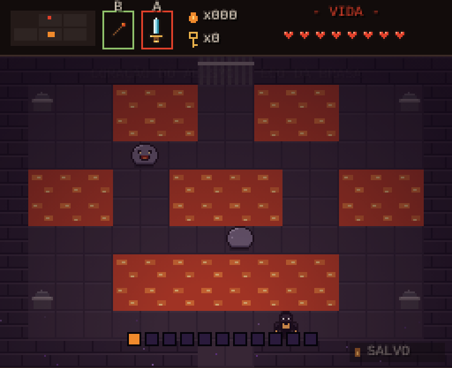

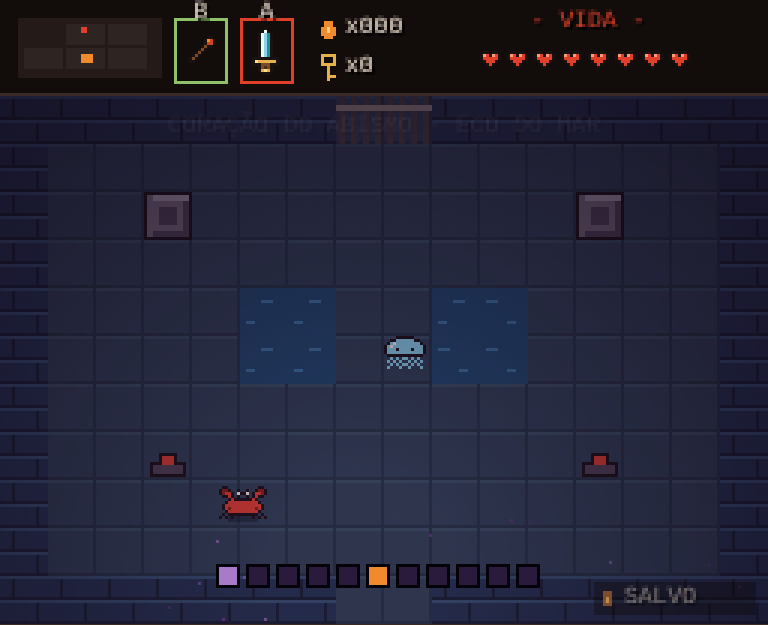

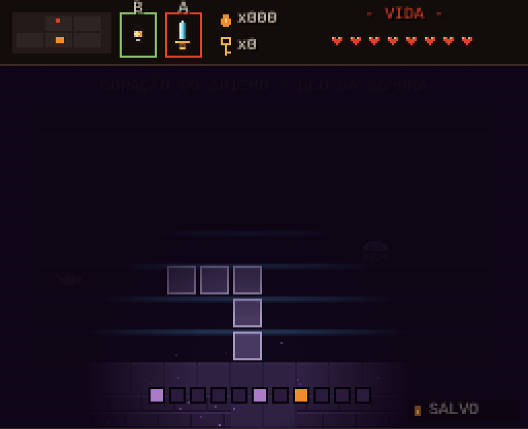

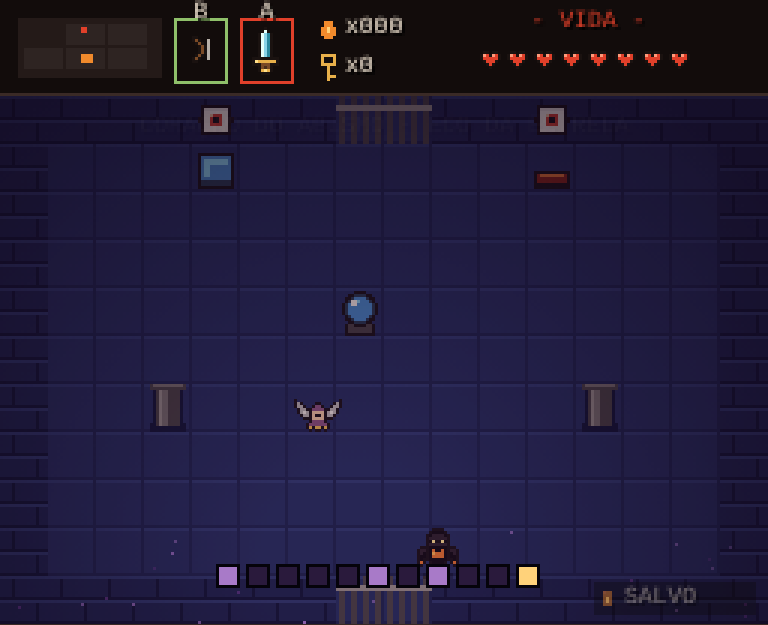

### A Sombra do Rei — batalha final

A luta tem **3 fases**; as marcas douradas na barra de vida mostram onde cada uma termina.

1. **Luz.** A Sombra é quase invisível e a espada a atravessa. Acenda as **4 chamas** dos cantos com o Bastão de Brasa: ela aparece por alguns segundos. Golpeie até ela engolir a luz e repita.
2. **Elementos.** A cada 5 segundos ela muda de forma. O item certo vai **sozinho para o botão B**: aperte B para desfazer a forma e então ataque com a espada:
   - **Gelo:** Bastão de Brasa
   - **Pedra:** Bomba
   - **Alada:** Gancho
   - **Blindada:** Martelo
   - **Olho:** Flecha
3. **Final.** O chão desaba e sobram ilhas de pedra. Só a **luz carregada** fere: **segure o botão de ataque** até a barrinha encher e aparecer "LUZ CARREGADA! SOLTE O BOTÃO", e solte para disparar 8 raios de luz. Um deles sempre sai mirando a Sombra. Pule as **ondas sombrias** com a **Pena** (ela já vai para o botão B) e não caia nos buracos entre as ilhas.

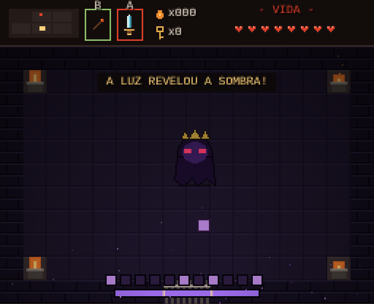

### Final

Vencida a Sombra, você volta ao Vale de Lume com a princesa, e vêm os **créditos**. Fique até o fim: há uma cena depois deles. O jogo fica salvo no Vale, com tudo completo.

## Chefes

Todo chefe tem uma fraqueza ligada a um item. Antes dela, a espada não faz dano. Abaixo da metade da vida, quase todos entram em **fúria** e ficam mais rápidos.

| Chefe | Onde | Como vencer |
| --- | --- | --- |
| Guardião de Cinzas | Castelo da Brasa | Acenda os braseiros com o Bastão de Brasa para derreter as cinzas e golpeie. As brasinhas cinzentas soltam corações |
| Kraken | Castelo das Marés | Quando ele emergir, puxe-o para a terra com o Gancho e golpeie |
| Grifo | Castelo dos Ventos | Ataque quando ele pousar e pule as ondas de choque com a Pena |
| Salamandra de Lava | Santuário do Fogo | Desvie das investidas. Quando ela bate na parede, fica tonta: golpeie |
| Caranguejo Rei | Gruta das Correntes | Vire-o de costas com o Gancho e golpeie |
| Escorpião Dourado | Templo do Sol | Flecha no olho deixa ele tonto; depois, espada |
| Flor Devoradora | Santuário da Floresta | Quando a boca abrir, o vento suga tudo: solte a bomba perto dela, deixe o vento puxar para dentro, ela murcha e leva golpes |
| Espectro | Santuário da Sombra | Acenda as 4 chamas da sala para ele aparecer e golpeie antes que as apague |
| Yeti das Neves | Santuário do Gelo | Congele-o com o Bastão de Gelo e golpeie |
| Cavaleiro da Lua | Ruínas da Lua | Uma martelada racha a armadura por alguns segundos; golpeie nesse tempo |
| Rei Umbra | Fortaleza Sombria | Rebata as esferas com a espada; tonto, ele leva golpes |
| Sombra do Rei | Coração do Abismo | Fase 1: 4 chamas. Fase 2: o item de cada forma. Fase 3: golpe de luz carregado (segure o ataque) |
| Guardião Estelar | Pico Estelar | Fase 1: flecha no olho aberto. Fase 2: bomba perto dele. Fase 3: puxe-o com o Gancho. Depois de cada uma, espada |

## Brasas: lojas e serviços

As **brasas** (contador laranja no topo da tela) são o dinheiro do jogo. Elas caem de inimigos, de arbustos e de baús, e o contador vai até 999.

### Mercador Pipo — Vale de Lume

Fica perto do topo do Vale de Lume, à direita do caminho.

| Mercadoria | Preço | O que faz |
| --- | --- | --- |
| Garrafa vazia | 50 | Guarda poções e fadas. Você pode ter até 3 |
| Poção vermelha | 30 | Enche toda a vida. Equipe a garrafa no botão B e use |
| Fada na garrafa | 70 | Se a vida acabar, ela te levanta na hora com 4 corações. Também pode ser usada no B |

### Ferreira Brígida — Vila de Conchas (Reino das Marés)

| Equipamento | Preço | O que faz |
| --- | --- | --- |
| Escudo de Ferro | 80 | Sem atacar, bloqueia projéteis que vêm de frente |
| Túnica Rubra | 150 | Você recebe metade do dano |
| Botas Ligeiras | 100 | Você anda mais rápido |

### Pedras da Águia — viagem rápida

Há uma **Pedra da Águia** no Vale de Lume, na Vila de Conchas e na Aldeia dos Ventos. Por **15 brasas**, uma águia leva você a qualquer outra aldeia que você já tenha visitado.

### Altares de Oferenda

Cada uma das três aldeias tem um **altar**. Ofereça **100 brasas** e a chama se acende: você ganha **1 pedaço de coração** (uma vez por altar).

### Mercadores escondidos

Três vultos encapuzados vendem itens raros nas salas secretas:

| Onde | Mercadorias |
| --- | --- |
| Câmara Esquecida, Castelo da Brasa (sala da parede oca) | **Amuleto da Onda** (120): a onda de brasa sai mesmo faltando 1 coração. Poção vermelha (20) |
| Sala secreta do Castelo das Marés | Garrafa vazia (40), Fada (45), Poção vermelha (20) |
| Câmara do Tesouro, Fortaleza Sombria (depois da armadilha) | **Recipiente de coração** (250, só um), Fada (40), Poção vermelha (20) |

**Dica:** antes do Rei Umbra e da Sombra do Rei, vá com as 3 garrafas cheias de fadas e com a Túnica Rubra.

## Segredos e dicas

Junte **4 pedaços de coração** para ganhar um coração inteiro; o menu mostra quantos você tem.

| Tesouro | Onde | O que precisa |
| --- | --- | --- |
| Recipiente de coração | Bosque Rubro, Enseada e Ponte das Nuvens | Explorar o mundo |
| Pedaço de coração | Arsenal (Castelo da Brasa) | Blocos nos botões; um bloco é falso |
| Pedaço de coração | Fosso de Lava (Castelo da Brasa) | Gancho até a ilha |
| Pedaço de coração | Ala Leste (Castelo das Marés) | Blocos nos botões |
| Pedaço de coração | Sala Secreta (Castelo dos Ventos) | Parede oca na Ala Oeste |
| Pedaço de coração | Penhasco (Reino dos Ventos) | Explorar o mundo |
| Pedaço de coração | Mar de Areia e Corredor dos Olhos (Sol) | Armadilha; flechas nos olhos |
| Pedaço de coração | Mirante dos Galhos e Galho Seco (Floresta) | Bombas nas rochas e na parede |
| Pedaço de coração | Labirinto das Almas (Sombra) | Pontes fantasmas |
| Pedaço de coração | Poço de Gelo (Gelo) | Congelar a água |
| Pedaço de coração | Observatório e Relicário (Lua) | Martelo nas armaduras; 3ª chave |
| Pedaço de coração | Torre dos Ventos Negros (Fortaleza Sombria) | Pena para pular os buracos |
| Pedaço de coração | Jardim Estelar (Estrela) | Acender os 4 braseiros a tempo |
| Pedaço de coração | Altares de Oferenda (Vale de Lume, Vila de Conchas, Aldeia dos Ventos) | 100 brasas em cada |
| 50 brasas | Uma sala selada em cada castelo e santuário | Parede oca ou parede de bomba |
| 50 brasas | Câmara do Tesouro (Fortaleza Sombria) | Vencer a armadilha |

- **Parede oca:** quando aparecer "A PAREDE PARECE OCA", dê 3 golpes de espada. Ela tem uma rachadura fina.
- **Parede de bomba:** a rachadura é grande e escura, e só cai com bomba. Ter as bombas cedo ajuda a pegar os extras ao voltar.
- **Mapa e bússola:** com a bússola, o mapa (TAB) mostra os baús que faltam e a sala do chefe.
- **Onda de brasa:** com a vida cheia, a espada ataca à distância. Ela também acerta orbes.
- **Orbes:** muitos quebra-cabeças pedem acertar o orbe **de longe** (bastão, gancho, bumerangue, flecha), para não ficar preso do lado errado dos pinos.
- **Se cair ou perder:** o jogo volta você à entrada da sala ou do castelo, e o progresso fica salvo.

