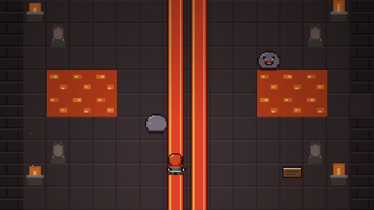

# Lenda da Brasa

Aventura clássica de ação em pixel art, ambientada no mundo de **Brasa Eterna**.
O Rei Umbra raptou a Princesa Lírian. Atravesse os reinos da **Brasa**, das **Marés** e dos **Ventos**,
conquiste os 3 cristais que libertam a **Espada dos Reinos** e depois busque os **8 Pendentes Celestiais**
que abrem o caminho até o Reino Sombrio.

**Jogar:** abra `index.html` no navegador (funciona com dois cliques, sem instalar nada)
ou jogue no [Portal Pixel](https://hebersonmiliano.github.io/portal-jogos/jogo.html?id=lenda-da-brasa).

📖 **[Guia completo com fotos](GUIA.md)**: rota de cada castelo e santuário, itens, chefes e segredos.



## O que dá para jogar

O jogo está completo, do começo ao final com créditos.

- **Capítulos 1 a 3**: Reino da Brasa, Reino das Marés e Reino dos Ventos, cada um com mundo aberto, castelo e chefe.
- **Lojas e serviços com brasas**: Mercador Pipo (garrafas, poções e fadas), Ferreira Brígida (escudo, túnica e botas), Pedras da Águia para viajar entre aldeias, Altares de Oferenda e 3 mercadores escondidos.
- **Capítulos 4 e 5**: Fortaleza Sombria (Rei Umbra) e Coração do Abismo (11 salas de memória e a Sombra do Rei).
- **Castelos com exploração de verdade** (52 salas no total), com mapa, bússola, chaves pequenas e chave mestra:
  - *Castelo da Brasa* (20 salas, térreo e subsolo): salas escuras, lava, orbes e pinos, Bastão de Brasa.
  - *Castelo das Marés* (16 salas): uma alavanca sobe e baixa a água de todo o castelo; Gancho.
  - *Castelo dos Ventos* (16 salas, 3 andares): pisos que desabam, correntes de vento, abismos; Pena.
- **Os 8 santuários dos Pendentes Celestiais**:
  - *Santuário do Fogo* (Vulcão) e *Gruta das Correntes* (Recifes): Salamandra de Lava e Caranguejo Rei.
  - *Templo do Sol* (Deserto Escaldante, a leste da Pedreira): 18 salas, **Arco** e olhos de pedra; Escorpião Dourado.
  - *Santuário da Floresta* (Floresta Antiga, a oeste do Charco): 18 salas em 3 andares, **Bombas**; Flor Devoradora.
  - *Santuário da Sombra* (Pântano Sombrio, a oeste das Dunas): 18 salas no escuro, **Lanterna** e pontes fantasmas; Espectro.
  - *Santuário do Gelo* (Geleira Eterna, ao norte dos Campos de Flores): 18 salas em 3 níveis, **Bastão de Gelo**; Yeti.
  - *Ruínas da Lua* (ao sul da Aldeia dos Ventos): 17 salas, **Martelo**, estacas e armaduras; Cavaleiro da Lua.
  - *Pico Estelar* (a oeste dos Campos de Flores): torre de 5 andares que exige todos os itens; Guardião Estelar.
  - Os portais dos santuários novos só reagem à Espada dos Reinos; o Pico Estelar pede os outros 7 Pendentes.
- Movimento e ataque em **8 direções**, menu de itens em grade no estilo dos clássicos de 16 bits, música de cada área,
  **3 espaços de salvamento**, suporte a **controle** e a **toque** no celular.

## Controles

| Ação | Teclado | Controle |
|---|---|---|
| Mover | WASD / setas | Direcional ou analógico |
| Espada, falar, abrir | J / Espaço / Z | A |
| Usar item | K / X | B ou X |
| Itens | I | Y |
| Pausa | Enter / Esc | Start |
| Mapa do castelo | TAB | Select |
| Som | M | — |

## Estrutura

```
index.html                     jogo pronto (folha de sprites embutida)
lenda-da-brasa-sprites.png     folha de sprites (o jogo usa esta se existir ao lado)
src/lenda-da-brasa.template.html   código do jogo (HTML + JavaScript)
src/castelos.js                dados dos castelos gerados por ferramentas/castelos.py
ferramentas/castelos.py        desenho das salas dos 3 castelos (com validação de portas e escadas)
ferramentas/santuarios.py      desenho das salas e regiões dos 6 santuários novos
ferramentas/gerar_brasa.py     gera todos os sprites em pixel art
ferramentas/build.py           monta o index.html
sprites/                       folha, atlas e prévia ampliada dos sprites
GUIA.md e guia/                guia completo do jogo, com fotos
```

## Como atualizar

```
python3 ferramentas/gerar_brasa.py   # só se mudar os sprites (precisa de Pillow)
python3 ferramentas/build.py         # gera index.html a partir do template e dos castelos
```

Para atualizar o Portal Pixel, copie `index.html`, `lenda-da-brasa-sprites.png` e `capa.png`
para `jogos/lenda-da-brasa/` no repositório do portal e aumente `versao` em `jogos.js`.

## Capítulos finais

Com os 8 pendentes, um portal no Vale de Lume leva à **Fortaleza Sombria** (12 salas) e ao duelo com o
**Rei Umbra**. Depois do resgate da princesa, a **Grande Porta** do abismo recebe os 3 cristais e os 8
pendentes, e as **11 salas de memória** do **Coração do Abismo** levam à batalha final em 3 fases contra a
**Sombra do Rei**. Créditos e cena pós-créditos incluídos. Veja o [guia completo](GUIA.md).

---
Criado por Heberson Miliano.
